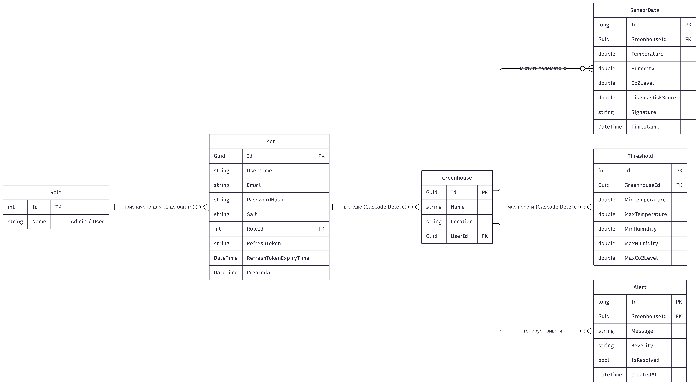

# SmartAgro - Інтелектуальна система моніторингу та захисту теплиць

Кросплатформна інтелектуальна IoT-система для агромоніторингу мікроклімату, оцінки фітосанітарних ризиків у реальному часі за допомогою машинного навчання (ONNX) та наскрізного криптографічного захисту телеметрії при передачі.


## Зміст

* [Архітектура проєкту](#архітектура-проєкту)

* [Архітектура бази даних (ER-діаграма)](#архітектура-бази-даних-er-діаграма)

* [Технологічний стек](#технологічний-стек)

* [Функціональні модулі та компоненти](#функціональні-модулі-та-компоненти)

* [Криптографічний протокол передачі (Data in Transit)](#криптографічний-протокол-передачі-data-in-transit)

* [Конвеєр машинного навчання (ML Pipeline)](#конвеєр-машинного-навчання-ml-pipeline)

* [REST API Ендпоінти](#rest-api-ендпоінти)

* [Встановлення та запуск бекенду і фронтенду](#встановлення-та-запуск-бекенду-і-фронтенду)

* [Контейнеризація (Docker)](#контейнеризація-docker)

* [Тестування та CI/CD](#тестування-та-cicd)

## Архітектура проєкту

Рішення побудоване за принципами Clean Architecture / Modular Monolith:

```
SmartAgro/
|-- SmartAgro.Api/           # Web API (Контролери, Middleware, Swagger, DI)
|-- SmartAgro.Core/          # Сутності, DbContext, ML-сервіси, крипта, воркери
|-- SmartAgro.Client/        # Кросплатформний мобільний / десктопний клієнт (.NET MAUI)
|-- SmartAgro.Web/           # Інтерактивний вебдашборд (React, Vite, TypeScript)
|-- SmartAgro.Tests/         # Модульні тести (xUnit) криптографії та бізнес-логіки
`-- ml_training/             # Скрипти навчання та експорту ONNX-моделі
```

## Архітектура бази даних (ER-діаграма)

Реляційна структура бази даних проєкту `SmartAgro` спроєктована на базі Entity Framework Core 10 (Code-First) та забезпечує надійну ізоляцію даних користувачів, облік теплиць, збір часових рядів телеметрії, налаштування порогових значень та аудит тривог.


### Основні реляційні зв'язки та оптимізація:

* **`Role`** $\leftrightarrow$ **`User`:** Рольова модель (`Admin`, `User`) для контролю доступу до функціоналу адміністратора.

* **`User`** $\leftrightarrow$ **`Greenhouse`:** Один користувач може володіти багатьма теплицями. Реалізовано каскадне видалення (`Cascade Delete`): при видаленні користувача його теплиці також видаляються.

* **`Greenhouse`** $\leftrightarrow$ **`SensorData`:** Зберігання метрик мікроклімату. Для прискорення пошуку часових рядів створено композитний індекс `HasIndex(s => new { s.GreenhouseId, s.Timestamp })`.

* **`Greenhouse`** $\leftrightarrow$ **`Threshold` та `Alert`:** Зв'язки для динамічного налаштування меж контролю та фіксації інцидентів/небезпечних станів.

## Технологічний стек

* **Бекенд та ядро:** .NET 10 (C# 13), Entity Framework Core 10 (Code-First)

* **Фронтенд (`SmartAgro.Web`):** React, Vite, TypeScript, Tailwind CSS, Lucide Icons, Chart.js

* **Кросплатформний клієнт (`SmartAgro.Client`):** .NET MAUI (Windows, Android)

* **База даних:** PostgreSQL / SQLite (вибір через конфігурацію `DatabaseProvider`)

* **Безпека:** JWT Bearer (AccessToken + RefreshToken), PBKDF2 Password Hashing, Rate Limiting

* **Криптографія:** AES-256-CBC, HMAC-SHA256, Constant-Time Comparison (`FixedTimeEquals`)

* **Машинне навчання:** Scikit-Learn, ONNX Runtime (`Microsoft.ML.OnnxRuntime`)

* **IoT / Фонова обробка:** `BackgroundService` (`IHostedService`), `PeriodicTimer`, SignalR (WebSocket)

* **Контейнеризація:** Docker, Docker Compose

* **Тестування:** xUnit

## Функціональні модулі та компоненти

### Модель даних та управління доступом

* **Реляційна структура (EF Core):** Сутності `User`, `Greenhouse`, `SensorData`, `Threshold`, `Alert` із налаштованими зовнішніми ключами та індексами для оптимізації вибірки телеметрії.

* **Автентифікація та авторизація:**

  * Реєстрація та безпечний вхід користувачів із хешуванням паролів за стандартом PBKDF2.

  * Видача пари токенів: короткоживучий `AccessToken` (JWT) та `RefreshToken` з механізмом ротації.

  * Захист ендпоінтів через атрибут `[Authorize]` та політиковий доступ (`RequireAdminOnly`).

### Автономний IoT-симулятор (`GreenhouseSimulatorService`)

* Працює як керована фонова служба (`BackgroundService`) з налаштовуваним інтервалом опитування.

* Математично моделює добові гармонійні коливання параметрів мікроклімату (температура, вологість повітря, концентрація CO2, вологість ґрунту).

* Періодично генерує критичні аномалії для стрес-тестування системи тривог.

### ML-інференс багатофакторної оцінки ризиків (`DiseasePredictionService`)

* Використовує попередньо навчену регресійну модель у форматі `greenhouse_risk.onnx`.

* Приймає вхідний тензор `[None, 4]` (температура, вологість повітря, CO2, вологість ґрунту) та за допомогою `InferenceSession` з ONNX Runtime розраховує вектор ризиків `[None, 4]` для прийняття рішень у реальному часі.

### Криптографічний захист телеметрії (`TelemetryCryptoService`)

* **Конфіденційність:** Дані шифруються симетричним алгоритмом AES-256-CBC із динамічним вектором ініціалізації (IV, 16 байт).

* **Цілісність та автентичність:** Формується криптографічний підпис HMAC-SHA256 від `IV + Ciphertext + Timestamp`.

* **Захист від підробок:** Верифікація підпису виконується в константному часі (`FixedTimeEquals`) для запобігання атакам за часом.

### Підсистема тривог (`AlertService`) та SignalR Real-Time

* Автоматично порівнює показники телеметрії з пороговими значеннями теплиці (`Thresholds`).

* Транслює оновлення показників у реальному часі за допомогою SignalR (`TelemetryHub`).

### Клієнтські інтерфейси (`SmartAgro.Web` та `SmartAgro.Client`)

* **`SmartAgro.Web`:** Інтерактивний вебдашборд для операторів агрокомплексу, для візуалізації поточного стану мікроклімату теплиць, перегляду історії показників та керування сповіщеннями про тривоги в реальному часі.

* **`SmartAgro.Client`:** Кросплатформний клієнт на базі .NET MAUI для мобільних та десктопних пристроїв.

## Криптографічний протокол передачі (Data in Transit)

Схема пакета `EncryptedTelemetryPackage`:

```
{
  "ciphertextBase64": "<AES-256-CBC Encrypted Payload>",
  "ivBase64": "<16-byte Cryptographic IV>",
  "hmacSignatureBase64": "<HMAC-SHA256 Signature>",
  "timestampUtc": "2026-10-04T15:00:00Z"
}
```

```
[IoT Device / Simulator]
        │
        ├─► 1. Серіалізація SensorData у JSON
        ├─► 2. Генерація унікального випадкового IV (16 байт)
        ├─► 3. Шифрування AES-256-CBC -> Ciphertext
        ├─► 4. Обчислення HMAC-SHA256(IV + Ciphertext + Timestamp) -> Signature
        ▼
[Відкритий канал зв'язку (Мережа)]
        ▼
[SmartAgro Ingestion Gateway]
        ├─► 5. Перевірка HMAC-SHA256 (FixedTimeEquals)
        │       ├── [Підпис не збігся] -> Відхилення (400 Bad Request, Security Alert)
        │       └── [Підпис валідний]    -> Перехід до кроку 6
        ├─► 6. Дешифрування AES-256-CBC з використанням отриманого IV
        ├─► 7. Десеріалізація об'єкта та збереження в БД
        └─► 8. Аудит і перевірка порогових значень у AlertService

```

## Конвеєр машинного навчання (ML Pipeline)

1. **Генерація датасету (`train_model.py`):** Створюється синтетична вибірка (5 000 зразків), що моделює нелінійні взаємозв'язки мікроклімату та розраховує 4 цільові фактори ризику:

   * `[0] FungalDiseaseRisk (%)` — нелінійна залежність ризику фітофторозу / борошнистої роси від вологості повітря, нелінійного температурного піку (Gaussian-like експонента навколо $22^\circ\text{C}$) та вологості ґрунту.

   * `[1] VpdStressRisk (%)` — транспіраційний стрес рослин на основі дефіциту тиску пари (VPD), обчисленого за формулою Тетенса (оптимальний діапазон $0.8\text{--}1.2\text{ kPa}$).

   * `[2] Co2InefficiencyRisk (%)` — стрес від відхилення концентрації вуглекислого газу від оптимальних меж (дефіцит $<600\text{ ppm}$ або надлишок $>1100\text{ ppm}$).

   * `[3] RootHypoxiaRisk (%)` — ризик гіпоксії кореневої зони через застій вологості ґрунту ($>70\%$) у поєднанні з підвищеною температурою.

2. **Навчання:** Використовується `MultiOutputRegressor` на базі ансамблю `RandomForestRegressor` (`n_estimators=35`, `max_depth=6`), що дозволяє одночасно прогнозувати всі 4 показники.

3. **Експорт в ONNX:** Модель конвертується через `skl2onnx` (opset 15) у файл `greenhouse_risk.onnx` із розмірністю входу `[None, 4]` та виходу `[None, 4]`.

## REST API Ендпоінти

### Автентифікація (`/api/auth`)

| Метод | Ендпоінт | Опис | Доступ | 
| ----- | ----- | ----- | ----- | 
| `POST` | `/api/auth/register` | Реєстрація нового користувача    | Публічний | 
| `POST` | `/api/auth/login`    | Вхід та отримання JWT токенів    | Публічний (захищено Rate Limiter) | 
| `POST` | `/api/auth/refresh`  | Оновлення пари токенів           | Публічний | 

### Теплиці (`/api/greenhouses`)

| Метод | Ендпоінт | Опис | Доступ | 
| ----- | ----- | ----- | ----- | 
| `GET`    | `/api/greenhouses`            | Отримати список теплиць (пошук, фільтрація, сортування) | Авторизований (користувач бачить свої, адмін — усі) | 
| `GET`    | `/api/greenhouses/all`        | Отримати всі теплиці в системі                          | Тільки Admin | 
| `GET`    | `/api/greenhouses/my`         | Отримати список власних теплиць користувача             | Авторизований | 
| `GET`    | `/api/greenhouses/{id}`       | Отримати детальну інформацію про теплицю за ID          | Авторизований (з перевіркою прав доступу) | 
| `POST`   | `/api/greenhouses`            | Створити новий тепличний сектор та початкові пороги     | Тільки Admin | 
| `PUT`    | `/api/greenhouses/{id}`       | Оновити назву, сектор або власника теплиці              | Тільки Admin | 
| `DELETE` | `/api/greenhouses/{id}`       | Демонтувати теплицю та видалити пов'язані ресурси       | Тільки Admin | 
| `GET`    | `/api/greenhouses/users-list` | Отримати список користувачів для призначення теплиці    | Тільки Admin | 

### Телеметрія (`/api/telemetry`)

| Метод | Ендпоінт | Опис | Доступ | 
| ----- | ----- | ----- | ----- | 
| `GET`  | `/api/telemetry/latest/{greenhouseId}`  | Останній зріз показників теплиці      | Авторизований | 
| `GET`  | `/api/telemetry/history/{greenhouseId}` | Історія показників сенсорів           | Авторизований | 
| `POST` | `/api/telemetry/secure-ingest`          | Захищений прийом зашифрованого пакета | Тільки Admin | 

### Сповіщення та інциденти (`/api/alerts`)

| Метод | Ендпоінт | Опис | Доступ | 
| ----- | ----- | ----- | ----- | 
| `GET`  | `/api/alerts/active`       | Список усіх активних тривог             | Авторизований | 
| `GET`  | `/api/alerts/history`      | Повна історія тривог із фільтрацією     | Авторизований | 
| `POST` | `/api/alerts/{id}/resolve` | Закриття (вирішення) тривоги оператором | Авторизований | 

## Встановлення та запуск бекенду і фронтенду

### 1. Клонування репозиторію

```powershell
git clone https://github.com/dariavysot/SmartAgro.git
cd SmartAgro
```

### 2. Налаштування конфігурації бекенду (`appsettings.json`)

Переконайтеся, що у файлі `SmartAgro.Api/appsettings.json` налаштовано провайдер БД та криптографічні ключі:

```json
{
  "DatabaseProvider": "PostgreSql",
  "ConnectionStrings": {
    "PostgreSql": "Host=localhost;Port=5432;Database=smartagro_db;Username=postgres;Password=postgres",
    "Sqlite": "Data Source=smartagro.db"
  },
  "CryptoSettings": {
    "AesKeyBase64": "k7P3mQ2x1A4bC6dE8fG0hI2jK4lM6nO8pQ0rStUvWxY=",
    "HmacKeyBase64": "dGhpcy1pcy1hLXNlY3VyZS02NC1ieXRlLWtleS1mb3ItaG1hYy1zaGEyNTYtc2lnbmluZy1zbWFydGFncm8tcHJvamVjdC1rZXk="
  }
}
```

### 3. Запуск бекенду (`SmartAgro.Api`)

```powershell
dotnet ef database update --project SmartAgro.Core --startup-project SmartAgro.Api
dotnet run --project SmartAgro.Api --launch-profile https

```

* **Swagger UI:** `https://localhost:7168/swagger` (або порт за замовчуванням у вашій консолі).

### 4. Запуск вебфронтенду (`SmartAgro.Web`)

Фронтенд-частина розроблена на React + Vite і за замовчуванням взаємодіє з локальним бекендом.

```powershell
cd SmartAgro.Web
npm install
npm run dev

```

* **Локальний URL:** `http://localhost:5173`

* **Порт:** `5173`

## Контейнеризація (Docker)

Проєкт підтримує розгортання інфраструктури через **Docker** та **Docker Compose**.

* **Хост (Host):** Локальне середовище розробника (`localhost` / `127.0.0.1`) або ізольована мережа Docker Bridge.

* **Налаштування файлу `.env`:**
  Перед запуском перевірте наявність та налаштування файлу `.env` у корені репозиторію для передачі секретів та паролів:

  ```
  POSTGRES_PASSWORD=SecretPassword123!
  JWT_SECRET_KEY=SmartAgro_Super_Secret_Key_For_Jwt_Security_2026!#
  AES_KEY_BASE64=k7P3mQ2x1A4bC6dE8fG0hI2jK4lM6nO8pQ0rStUvWxY=
  HMAC_KEY_BASE64=dGhpcy1pcy1hLXNlY3VyZS02NC1ieXRlLWtleS1mb3ItaG1hYy1zaGEyNTYtc2lnbmluZy1zbWFydGFncm8tcHJvamVjdC1rZXk=
  
  ```

* **Запуск через Docker Compose:**
  У корені репозиторію виконайте команду для підняття контейнерів бази даних PostgreSQL та сервісів:

  ```powershell
  docker compose up --build -d
  ```

* Контейнер бази даних за замовчуванням слухає стандартний порт PostgreSQL (`5432`), який мапиться на хост-машину, що дозволяє бекенду легко підключатися до нього через `Host=localhost;Port=5432`.

## Тестування та CI/CD

Проєкт містить комплекс модульних тестів (**xUnit** у `SmartAgro.Tests`), які охоплюють криптографічний захист (`TelemetryCryptoService`), автентифікацію і токени (`TokenService`), хешування паролів (`Pbkdf2PasswordHasher`) та бізнес-логіку тривог (`AlertService`).

### Локальний запуск тестів із покриттям:

```powershell
dotnet test SmartAgro.Tests/SmartAgro.Tests.csproj --collect:"XPlat Code Coverage" --settings SmartAgro.Tests/coverlet.runsettings
```

### Автоматизований CI/CD (GitHub Actions):

У репозиторії налаштовано конвеєр (`.github/workflows/ci.yml`), який під час кожного пушу чи pull-request-у у гілки `develop` / `main`:

1. Підіймає ізольоване середовище на Linux-сервері.

2. Інсталює .NET 10 SDK, відновлює залежності та збирає проєкт.

3. Проганяє юніт-тести із збором метрик покриття коду (з виключенням автозгенерованих міграцій EF Core через `coverlet.runsettings`).

4. Генерує інтерактивний HTML-звіт через `ReportGenerator` та вивантажує його як артефакт (`CodeCoverageReport`), а також публікує зведення у вкладці *Summary*.

